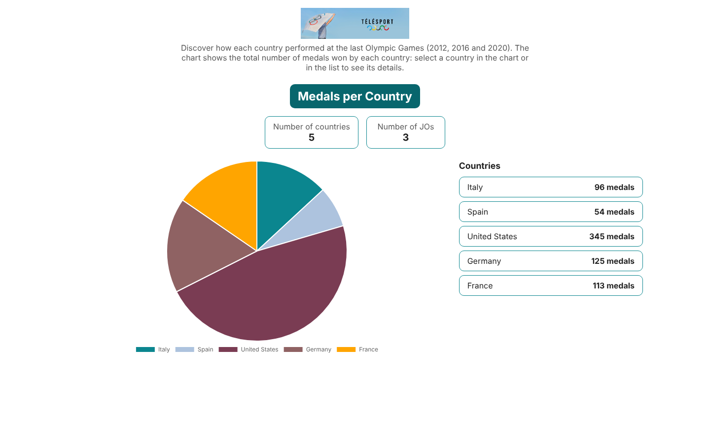
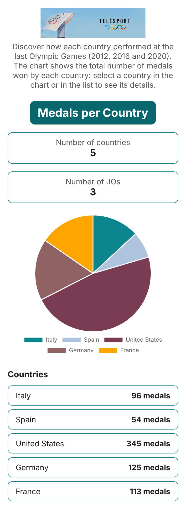
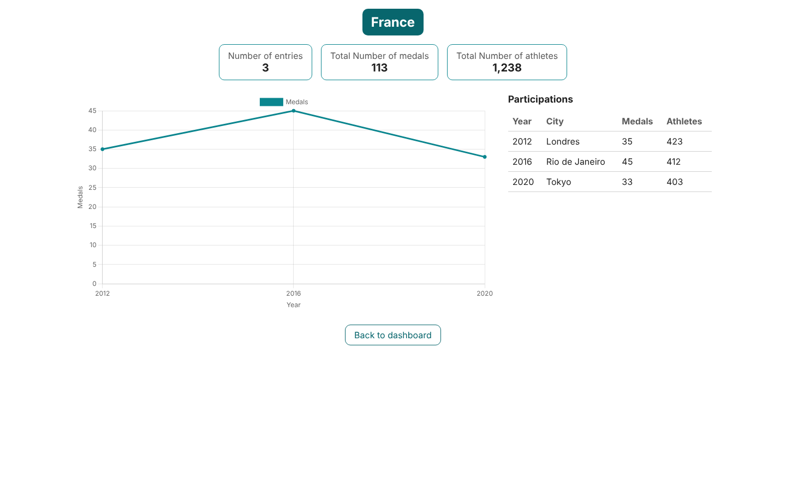
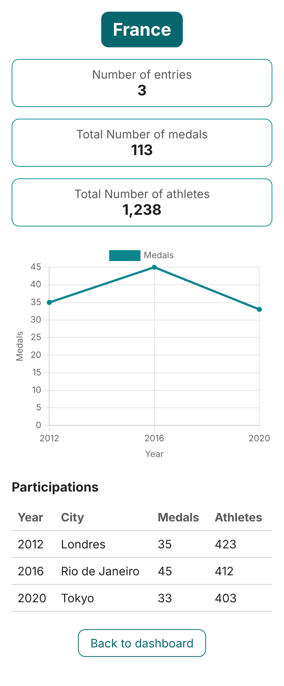
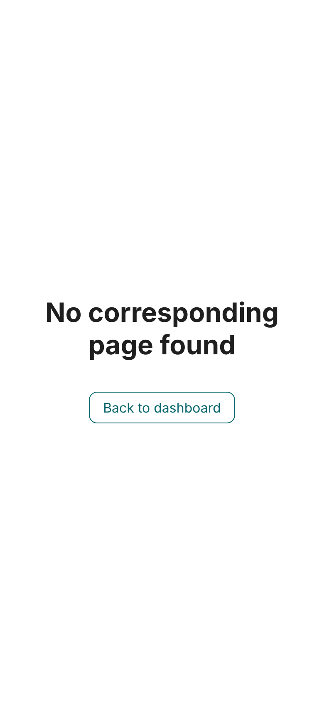

# Télésport — Jeux Olympiques

Application Angular qui présente les performances des pays aux Jeux olympiques : un dashboard avec le nombre de médailles par pays et une page de détail par pays.

## Sommaire

1. [Prérequis](#prérequis)
2. [Installation et lancement](#installation-et-lancement)
3. [Scripts](#scripts)
4. [Fonctionnalités](#fonctionnalités)
5. [Structure du projet](#structure-du-projet)
6. [Captures d'écran](#captures-décran)
7. [Gestion des erreurs](#gestion-des-erreurs)
8. [Limites connues](#limites-connues)
9. [Documentation](#documentation)

## Prérequis

- Node.js 18.19 ou plus récent (avec npm)
- Angular CLI 18 : `npm install -g @angular/cli@18`

## Installation et lancement

```bash
git clone https://github.com/Payetthomas/D-finissez-et-d-veloppez-le-front-end-en-utilisant-du-code-Angular-maintenable.git
cd D-finissez-et-d-veloppez-le-front-end-en-utilisant-du-code-Angular-maintenable
npm install
ng serve
```

Ouvrir ensuite `http://localhost:4200/`.

## Scripts

| Commande | Rôle |
|---|---|
| `npm start` (`ng serve`) | serveur de développement |
| `npm run build` | build de production dans `dist/` |
| `npm run lint` | vérification du code (ESLint) |
| `npm test` | tests unitaires (Karma, navigateur ouvert) |
| `npm run test:ci` | tests unitaires sans navigateur visible (Chrome headless) |

## Fonctionnalités

- **`/` — dashboard** : texte introductif, nombre de pays et de JO, camembert des médailles par pays, liste des pays. Un clic sur une part du camembert ou sur un pays de la liste ouvre sa page de détail.
- **`/country/:id` — détail d'un pays** : nombre de participations, total des médailles et des athlètes, courbe des médailles par édition, tableau des participations, bouton de retour.
- **Responsive** : desktop (≥ 1200px), tablette (768–1199px) et mobile (≤ 767px).
- **Accessibilité de base** : titres de page, descriptions textuelles des graphiques, navigation au clavier, focus visible.

## Structure du projet

```
src/app/
├── components/   composants réutilisables (header, graphiques)
├── pages/        pages reliées aux routes (dashboard, country-detail, not-found)
├── services/     DataService : accès aux données et calculs
└── models/       interfaces TypeScript
```

Les données sont simulées dans `src/assets/mock/olympic.json`. Le détail de l'architecture est dans [`ARCHITECTURE.md`](ARCHITECTURE.md).

## Captures d'écran

| | Desktop | Mobile |
|---|---|---|
| Dashboard |  |  |
| Détail d'un pays |  |  |
| Page introuvable |  |  |

Toutes les captures sont aussi regroupées dans `docs/screenshots.zip`.

## Gestion des erreurs

| Cas | Comportement |
|---|---|
| URL inconnue (ex. `/abc`) | page « No corresponding page found » + bouton de retour |
| Pays inexistant ou id invalide (`/country/99`, `/country/abc`) | redirection vers `/not-found` |
| Échec du chargement des données | message clair + bouton « Try again » (dashboard) ou « Back to dashboard » (détail) |
| Pays sans participation | message « No data available. » |

Pour tester l'échec du chargement : renommer temporairement `src/assets/mock/olympic.json`, ou bloquer cette requête dans l'onglet Réseau des DevTools.

## Limites connues

- Les données sont simulées dans un fichier JSON : pas encore de connexion à une API.
- L'id du pays est lu une seule fois (`route.snapshot`) : suffisant pour la navigation actuelle, qui repasse toujours par le dashboard.

## Documentation

- [`ARCHITECTURE.md`](ARCHITECTURE.md) : arborescence, composants, service, flux des données, patterns et décisions.
- [`notes-architecture.md`](notes-architecture.md) : audit du starter, plan d'architecture et refactor réalisé.
